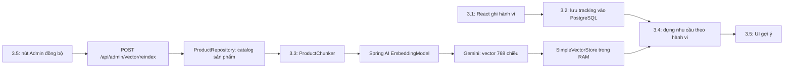

# Mục 3.3 — Văn Nhựt: Spring AI Vector Store & Ingestion Pipeline

Tài liệu hướng dẫn đọc code, chạy và kiểm thử phần 3.3 theo [kế hoạch phân công](KE_HOACH_PHAN_CONG_CONG_VIEC_SPRING_AI_NHOM16.md). Kết quả kiểm tra ngày **09/11/2026**, giờ Việt Nam: **24/24 test mục 3.3 pass**, bao gồm test Gemini thật. Test hồi quy toàn backend: **162 test được báo cáo, 141 pass, 21 skip, 0 failure, 0 error**. Các test có điều kiện về database/live không đủ cấu hình sẽ skip, không được tính là pass.

## 1. Phần này làm gì, liên quan search/tư vấn ra sao?

Search và tư vấn đã có sẵn trước thay đổi này:

- `catalog/application/SmartSearchService.java`: dùng Spring AI phân tích câu tìm thành tiêu chí rồi lọc catalog.
- `advisory/AiAdvisorService.java`: chọn ứng viên, gọi AI và kiểm tra kết quả tư vấn.
- `ai/AiGateway.java`: gọi chat model thông qua Spring AI `ChatClient`.

**Mục 3.3 bổ sung hạ tầng dữ liệu vector** cho hệ thống gợi ý trong kế hoạch. Các ô search/chat hiện tại chưa tự chuyển sang dùng vector chỉ vì thêm package này. Việc truy vấn ngữ nghĩa, cá nhân hóa theo tracking và kiểm tra tương thích thuộc 3.4; widget và nút đồng bộ thuộc 3.5.

Luồng các phần kết nối với nhau:



3.3 đọc **sản phẩm**, không đọc hoặc embedding nhật ký hành vi. Mục 3.4 sẽ nhận cả dữ liệu sở thích từ service của Nhân và bean `VectorStore` của Nhựt để kết hợp chúng. Vì vậy 3.3 có thể kiểm thử trước khi UI gợi ý hoàn thành.

## 2. Vị trí code

Đường dẫn gốc Java: `src/main/java/iuh/fit/nhom16/pcstore/`.

| File | Vai trò |
| --- | --- |
| [`ai/vector/VectorStoreConfig.java`](../src/main/java/iuh/fit/nhom16/pcstore/ai/vector/VectorStoreConfig.java) | Khởi tạo Google client, bean `EmbeddingModel` và bean `VectorStore`. |
| [`ai/vector/ProductChunker.java`](../src/main/java/iuh/fit/nhom16/pcstore/ai/vector/ProductChunker.java) | Chuyển `Product` cùng thông số thành các `Document`, kèm metadata. |
| [`ai/vector/ProductVectorIngestionService.java`](../src/main/java/iuh/fit/nhom16/pcstore/ai/vector/ProductVectorIngestionService.java) | Thực hiện toàn bộ `reindexAll()`: đọc DB, chunk, embed, load. |
| [`ai/vector/ProductEmbeddingModel.java`](../src/main/java/iuh/fit/nhom16/pcstore/ai/vector/ProductEmbeddingModel.java) | Bọc model thật của Spring AI: chặn thiếu key, kiểm tra vector, chuyển lỗi provider thành lỗi API. |
| [`ai/vector/ProductVectorStore.java`](../src/main/java/iuh/fit/nhom16/pcstore/ai/vector/ProductVectorStore.java) | Bọc `SimpleVectorStore`, thay toàn bộ dữ liệu sau khi ingestion thành công. |
| [`ai/vector/AdminVectorController.java`](../src/main/java/iuh/fit/nhom16/pcstore/ai/vector/AdminVectorController.java) | Endpoint Admin để chạy đồng bộ, sẵn cho nút của Bửu. |

Các thay đổi cấu hình dùng chung cần thiết:

- `pom.xml`: thêm `spring-ai-google-genai-embedding` và `spring-ai-vector-store`, giữ nguyên Spring AI BOM **2.0.2** của dự án.
- `src/main/resources/application.yml`: model embedding và số chiều.
- `.env.example`: ví dụ biến môi trường, không chứa API key thật.

Không sửa các file của Cảnh/Nhân, không thêm migration và không triển khai service/UI của mục 3.4–3.5.

## 3. Giải thích `VectorStoreConfig.java`

Spring đọc file `.env` nhờ `spring.config.import` đã có sẵn trong `application.yml`. `AiSettings` nhận `GEMINI_API_KEY`, URL và timeout dùng chung với search/chat. Hai thuộc tính mới là:

```yaml
app:
  ai:
    vector:
      model: ${GEMINI_EMBEDDING_MODEL:gemini-embedding-001}
      dimensions: ${GEMINI_EMBEDDING_DIMENSIONS:768}
```

`GEMINI_MODEL` là model chat hiện tại. `GEMINI_EMBEDDING_MODEL` là model **chuyển văn bản thành mảng số**, hai việc khác nhau. API key có thể dùng chung nếu được Google cấp quyền.

Đoạn khởi tạo model:

```java
var connection = GoogleGenAiEmbeddingConnectionDetails.builder()
        .genAiClient(productEmbeddingClient).build();
var options = GoogleGenAiTextEmbeddingOptions.builder()
        .model(model).dimensions(dimensions).build();
var delegate = new GoogleGenAiTextEmbeddingModel(connection, options,
        new RetryTemplate(RetryPolicy.withMaxRetries(0)));
return new ProductEmbeddingModel(delegate, settings.configured(), dimensions);
```

- `connection`: dùng Google SDK client đã cấu hình API key, URL và timeout.
- `options`: yêu cầu model embedding và số chiều, mặc định 768.
- `delegate`: model chính thức của Spring AI thực sự gọi Google.
- `ProductEmbeddingModel`: xác minh vector trả về, không tạo vector giả để che lỗi.
- `RetryPolicy.withMaxRetries(0)`: không tự gọi lại ở lớp Spring AI.

Google SDK cũng được cấu hình `attempts(1)` và danh sách HTTP status cần retry rỗng. Khi kiểm thử, SDK **1.65.0** vẫn chờ backoff ở status 429/503 dù chỉ có một attempt; bỏ các status retry tránh việc chờ này biến lỗi quota thành timeout. Test HTTP xác nhận mỗi lần lỗi chỉ phát sinh **một request provider**.

Ứng dụng vẫn tạo được bean khi chưa có key; thao tác embedding/reindex sẽ trả lỗi `VECTOR_NOT_CONFIGURED`. Khởi động backend không tự gửi yêu cầu embedding và không tự đồng bộ cả catalog.

Bean store:

```java
@Bean
ProductVectorStore vectorStore(EmbeddingModel productEmbeddingModel) {
    return new ProductVectorStore(productEmbeddingModel);
}
```

`ProductVectorStore implements VectorStore`, nên phía 3.4 vẫn inject bằng interface chuẩn `org.springframework.ai.vectorstore.VectorStore` được.

## 4. Giải thích `ProductChunker.java`

Phương thức vào là `List<Document> chunk(Product product)`. Một sản phẩm ngắn thường tạo **một** document. Mô tả dài sẽ tạo nhiều document, mỗi document giữ tên, danh mục, thương hiệu và thông số để không mất ngữ cảnh.

Ví dụ dữ liệu nguồn có thể tạo văn bản:

```text
Sản phẩm: Intel Core i5 12400F
SKU: CPU-I5-12400F
Danh mục: CPU
Thương hiệu: Intel
CPU: Intel Core i5 12400F
Mainboard: H610/B760 LGA1700
Mô tả: Socket LGA1700, 6 nhân 12 luồng, boost 4.4GHz, TDP 65W. Phù hợp chơi game.
```

Thông tin được lấy từ `Product` và `ProductSpec`: CPU, GPU, RAM, dung lượng/loại ổ, mainboard, PSU, case, hệ điều hành. Giá trị trống sẽ được bỏ qua. HTML thông thường được bỏ thẻ và khoảng trắng được chuẩn hóa.

**Điểm cần hiểu khi bảo vệ:** Entity hiện tại chưa có cột `socket`, số nhân hay TDP riêng. Code giữ những thông tin đó nếu có trong tên, mô tả hoặc chuỗi thông số nguồn; không tự suy đoán CPU nào dùng socket nào. Mục 3.4 cần dữ liệu đủ và kiểm tra DB khi làm guardrails.

`splitDescription()` chia phần mô tả thành đoạn tối đa **1.200 ký tự**, ưu tiên ngắt tại khoảng trắng và tránh cắt đôi surrogate pair của Unicode. Đây là chia văn bản theo ngữ cảnh sản phẩm, **không phải băm mật mã**. Dùng giới hạn ký tự giúp đoạn mô tả ngắn hơn, nhưng không khẳng định số ký tự bằng số token. Phần tiêu đề/thông số được lặp lại ngoài giới hạn mô tả này.

Mỗi đoạn gắn metadata:

| Key | Ví dụ / ý nghĩa |
| --- | --- |
| `productId` | UUID sản phẩm thật, dùng tìm lại bản ghi DB. |
| `price` | Số thực, snapshot giá lúc đồng bộ. |
| `category` | Slug như `cpu`, đồng nhất với loại dữ liệu tracking. |
| `stockOnHand` | Tồn kho gốc trong `Product`. |
| `availableStock` | `max(0, stockOnHand - reservedQuantity)`, số lượng có thể mua. |
| `status` | Trạng thái sản phẩm. |
| `chunkIndex`, `chunkCount` | Số thứ tự đoạn, tổng số đoạn của sản phẩm. |

ID document được tạo ổn định:

```java
UUID.nameUUIDFromBytes(("product:" + product.getId() + ":chunk:" + index)
        .getBytes(StandardCharsets.UTF_8)).toString();
```

Cùng sản phẩm và số thứ tự đoạn tạo cùng document ID. Hàm này tạo **ID ổn định**, không phải embedding. Giá/tồn kho chỉ ở metadata; `ProductEmbeddingModel.embed(Document)` chỉ đưa `document.getText()` sang Google, tránh để giá/tồn kho làm nhiễu văn bản ngữ nghĩa.

## 5. Giải thích `reindexAll()` và vị trí sinh vector

Luồng xử lý trong `ProductVectorIngestionService`:

1. Kiểm tra key; thiếu key trả 503 trước khi đọc DB/gọi Google.
2. `reindexLock.tryLock()` từ chối lượt đồng bộ thứ hai bằng 409 nếu đang có lượt chạy.
3. Đọc `products.findAll()` trong transaction chỉ đọc, lấy sản phẩm `ACTIVE`.
4. Gọi `chunker.chunk(p)` rồi gom toàn bộ document.
5. Kết thúc transaction DB trước khi gọi mạng, tránh giữ connection trong lúc đợi Google.
6. Gọi `vectorStore.replaceAll(snapshot.documents())` để embed và lưu dữ liệu mới.
7. Trả số sản phẩm, số document và thời điểm hoàn tất; luôn mở khóa trong `finally`.

Đoạn cốt lõi của store:

```java
synchronized void replaceAll(List<Document> documents) {
    var staging = SimpleVectorStore.builder(embeddingModel).build();
    if (!documents.isEmpty()) staging.add(documents);
    current = staging;
}
```

`staging.add(documents)` chính là bước **Embed + Load**. Spring AI `SimpleVectorStore` tự gọi `EmbeddingModel.embed(document)` cho từng document, lấy `float[]` từ Gemini rồi lưu vector cùng text/metadata. Không cần tự viết phép biến đổi text thành vector trong Java.

Chỉ sau khi toàn bộ `add` thành công mới gán `current = staging`. Nếu lỗi ở document thứ hai, store cũ vẫn nguyên vẹn, cả document đầu tiên của lượt lỗi cũng chưa được công bố. `volatile` giúp các luồng tìm kiếm nhìn thấy snapshot mới đã được publish. Tìm kiếm đang chạy tiếp tục sử dụng snapshot mà nó đã đọc.

Reindex là **thay thế toàn bộ**: sản phẩm bị xóa, ngừng bán hoặc giảm số chunk sẽ không để lại document cũ. Catalog không còn sản phẩm ACTIVE sẽ thay bằng store rỗng. Sản phẩm hết hàng vẫn được index với tồn kho đúng; lọc còn hàng là trách nhiệm 3.4.

**Nơi lưu:** RAM của tiến trình Java qua `SimpleVectorStore`, phù hợp lựa chọn dev trong kế hoạch. Chưa cấu hình PgVector, chưa tạo bảng vector trong PostgreSQL, chưa lưu file snapshot. Restart backend sẽ mất index; cần reindex lại. Có nhiều instance backend thì mỗi instance có store riêng.

## 6. Chạy backend và gọi API độc lập UI

Yêu cầu: Java 21+, database của dự án hoạt động, `.env` đặt ở thư mục gốc:

```properties
GEMINI_API_KEY=your-server-side-key
GEMINI_EMBEDDING_MODEL=gemini-embedding-001
GEMINI_EMBEDDING_DIMENSIONS=768
```

Giữ các biến DB và cấu hình sẵn có. Chỉ thêm hai biến embedding nếu muốn ghi rõ; code đã có giá trị mặc định. Sau khi sửa `.env`, restart backend:

```powershell
cd D:\PC_Store_WWW_Programming
.\mvnw.cmd spring-boot:run
```

Terminal PowerShell khác có thể dùng CSRF và Basic Auth của profile `local`:

```powershell
$baseUrl = 'http://localhost:8080'
$csrfInfo = Invoke-RestMethod "$baseUrl/api/csrf" -SessionVariable vectorSession
$adminCredential = Get-Credential -Message 'Nhập tài khoản Admin của profile local'
$plainAuth = '{0}:{1}' -f $adminCredential.UserName, $adminCredential.GetNetworkCredential().Password
$basicAuth = [Convert]::ToBase64String([Text.Encoding]::UTF8.GetBytes($plainAuth))
$vectorHeaders = @{ Authorization = "Basic $basicAuth" }
$vectorHeaders[$csrfInfo.headerName] = $csrfInfo.token
Invoke-RestMethod "$baseUrl/api/admin/vector/reindex" -Method Post `
    -WebSession $vectorSession -Headers $vectorHeaders -TimeoutSec 600
```

Nhập Admin đã cấu hình trong `ADMIN_USERNAME`/`ADMIN_PASSWORD`. Mặc định local trong cấu hình dự án là `admin`/`admin1234`. Endpoint yêu cầu cả **ROLE_ADMIN** và **CSRF**, không mở công khai. Reindex gọi Gemini cho từng document nên thời gian/quota phụ thuộc số sản phẩm; nó chỉ chạy khi chủ động gọi API.

Ví dụ hợp đồng thành công, các con số dưới đây chỉ minh họa:

```json
{
  "status": "SUCCESS",
  "productCount": 10,
  "documentCount": 12,
  "completedAt": "2026-11-09T13:29:10Z"
}
```

`productCount` đếm sản phẩm ACTIVE; `documentCount` đếm các đoạn văn bản nên có thể lớn hơn. `completedAt` là UTC; UI có thể hiển thị theo giờ địa phương.

| HTTP | Ý nghĩa |
| --- | --- |
| 200 | Đã thay toàn bộ index thành công. |
| 401 / 403 | Chưa xác thực, thiếu quyền hoặc thiếu/sai CSRF. |
| 409 | `VECTOR_REINDEX_IN_PROGRESS`: một lượt đang chạy. |
| 429 | `VECTOR_QUOTA_EXCEEDED`, có `Retry-After: 60`. |
| 503 | `VECTOR_NOT_CONFIGURED` hoặc `VECTOR_ACCESS_DENIED`. |
| 502 | `VECTOR_EMBEDDING_FAILED`: provider lỗi, timeout hoặc vector không hợp lệ. |

Metadata giá/tồn kho là snapshot tại lần đồng bộ. Phía 3.4 phải đọc lại giá, trạng thái và số lượng có thể mua từ DB trước khi gợi ý/đặt hàng.

## 7. Kiểm thử và minh chứng

Ảnh: [pass.png](testing/evidence/spring-ai-3.3/pass.png). Đây là **ảnh trình duyệt chụp báo cáo từ JUnit/Maven thật**, không phải ảnh UI gợi ý. Bản gốc có thể mở bằng [report.html](testing/evidence/spring-ai-3.3/report.html), đối chiếu [results.json](testing/evidence/spring-ai-3.3/results.json), [log tổng hợp Maven](testing/evidence/spring-ai-3.3/maven-summary.txt) và [kết quả hồi quy](testing/evidence/spring-ai-3.3/regression-summary.txt).

| Test suite trong `src/test/java/.../ai/vector/` | Số test | Chứng minh |
| --- | --- | --- |
| `ProductChunkerTest` | 3 | Giữ thông số, metadata có kiểu số; mô tả dài giữ nội dung; không bịa trường thiếu. |
| `ProductVectorIngestionServiceTest` | 6 | Cập nhật/xóa không trùng, giữ snapshot khi lỗi, hết transaction trước HTTP, thiếu key, concurrent reindex. |
| `AdminVectorControllerTest` | 4 | Dùng SecurityConfig thật: 401/403, Admin+CSRF thành công, trả lỗi quota đúng. |
| `VectorStoreConfigTest` | 2 | Spring tạo được bean khi thiếu key; chặn URL provider ngoài phạm vi cấu hình. |
| `VectorEmbeddingHttpTest` | 8 | Google SDK/Spring AI gọi HTTP thật tới Postman local, load/search được và xử lý bảy tình huống lỗi. |
| `VectorEmbeddingLiveTest` | 1 | **Google thật**: embed sản phẩm và truy vấn cùng nội dung, vector 768 chiều, self-similarity xấp xỉ 1. |

Các test này dùng ProductRepository fixture; không khẳng định đã chạy `reindexAll()` trên toàn bộ DB thực tế. Test live xác nhận đường gọi embedding thật và store, chưa đo chất lượng tìm kiếm ngữ nghĩa với nhiều sản phẩm.

Chạy test logic + bảo mật, không cần key, DB hoặc Postman:

```powershell
.\mvnw.cmd test "-Dtest=ProductChunkerTest,ProductVectorIngestionServiceTest,AdminVectorControllerTest,VectorStoreConfigTest"
```

Chạy thêm kiểm thử HTTP giả lập. Terminal 1:

```powershell
postman simulation run postman/simulations/pcstore-vector.sim.yaml --port 4901 --no-history
```

Terminal 2:

```powershell
.\mvnw.cmd test "-Dtest=iuh.fit.nhom16.pcstore.ai.vector.*Test" `
    "-Dvector.simulation.url=http://127.0.0.1:4901/embedding"
```

Để lặp lại **đúng bộ 24 test có Gemini thật**, thêm `"-Dvector.live=true"` vào lệnh trên. Chỉ bật khi có key và muốn dùng hai lượt gọi Google. Khi không bật, test live sẽ skip có chủ đích. Mock HTTP nằm trong `postman/mocks/pcstore-gemini-embedding/`, dùng vector tổng hợp cho kiểm thử hợp đồng, không dùng trong sản phẩm.

Test hồi quy hiện có, bao gồm search/chat HTTP cũ:

```powershell
# Terminal riêng, đồng thời giữ simulation embedding tại 4901
postman simulation run postman/simulations/pixelcore-advisor.sim.yaml --port 4902 --no-history

# Terminal chạy test
.\mvnw.cmd test "-Dvector.simulation.url=http://127.0.0.1:4901/embedding" `
    "-Dai.simulation.url=http://127.0.0.1:4902/gemini"
```

Kết quả đã chạy: **162 reported; 141 passed; 21 skipped; build success**. Trong đó test tracking 3.2 và các test search/chat được chạy lại. Các suite DB tích hợp yêu cầu biến môi trường riêng vẫn skip.

Script [`scripts/capture-vector-evidence.py`](../scripts/capture-vector-evidence.py) lấy số liệu trực tiếp từ JUnit XML, không chép các system properties/API key vào báo cáo. Nếu tái tạo minh chứng, chạy nó ngay sau bộ test 24 case, trước khi các lệnh test khác ghi đè report; truyền các đường dẫn log đã lưu và `--chrome` trỏ tới Chrome/Chromium để chụp ảnh.

## 8. Bàn giao cho hai thành viên tiếp theo

**Cho Ngân — 3.4:** inject `VectorStore` như bean Spring thông thường. API builder của phiên bản 2.0.2 trong repo là:

```java
var documents = vectorStore.similaritySearch(SearchRequest.builder()
        .query(userPrompt)
        .topK(5)
        .similarityThreshold(0.70)
        .build());
```

Đây là ví dụ bàn giao, chưa thêm service recommendation vào code. Lấy `productId` từ metadata, gộp các chunk cùng sản phẩm, đọc lại DB để kiểm tra giá/tồn kho/trạng thái/tương thích. `UserTrackingService.getTopCategories(sessionId, userId, 7)` đã có ở phần của Nhân để dựng ngữ cảnh. Ngưỡng 0.70 và logic guardrails thuộc 3.4.

**Cho Bửu — 3.5:** gọi `POST /api/admin/vector/reindex` bằng client có authentication/CSRF hiện tại; dùng `productCount` cho thông báo số sản phẩm đã đồng bộ, `documentCount` cho số đoạn vector. Chỉ báo thành công khi nhận HTTP 200 và `status=SUCCESS`; hiển thị lỗi API khi quota/timeout. Request này có thể lâu hơn thao tác CRUD thông thường nên timeout của client cần phù hợp catalog.

## 9. Gợi ý trả lời khi thuyết trình

> Phần của em thực hiện ETL cho dữ liệu sản phẩm. `ProductChunker` lấy tên, loại, hãng, thông số và mô tả, chia thành các document có metadata nhận diện sản phẩm. `ProductVectorIngestionService.reindexAll()` đọc catalog và gọi store nạp document. Spring AI dùng Google Gemini EmbeddingModel biến text thành vector 768 chiều. Vector được lưu trong SimpleVectorStore ở RAM cho môi trường dev. Em dựng store tạm và chỉ thay store đang dùng khi toàn bộ lượt nạp thành công. Em đã kiểm thử độc lập UI bằng unit test, HTTP giả lập lỗi và hai request tới Google thật. Phần dùng tracking để tìm sản phẩm tương đồng và hiển thị sẽ được nối tiếp ở 3.4 và 3.5.

Tài liệu API đối chiếu: [Spring AI Google GenAI text embeddings](https://docs.spring.io/spring-ai/reference/api/embeddings/google-genai-embeddings-text.html), [Google embedding API](https://ai.google.dev/api/embeddings). Khi triển khai đã kiểm tra cả source JAR Spring AI **2.0.2** trong Maven local để dùng đúng package/chữ ký của phiên bản dự án.
